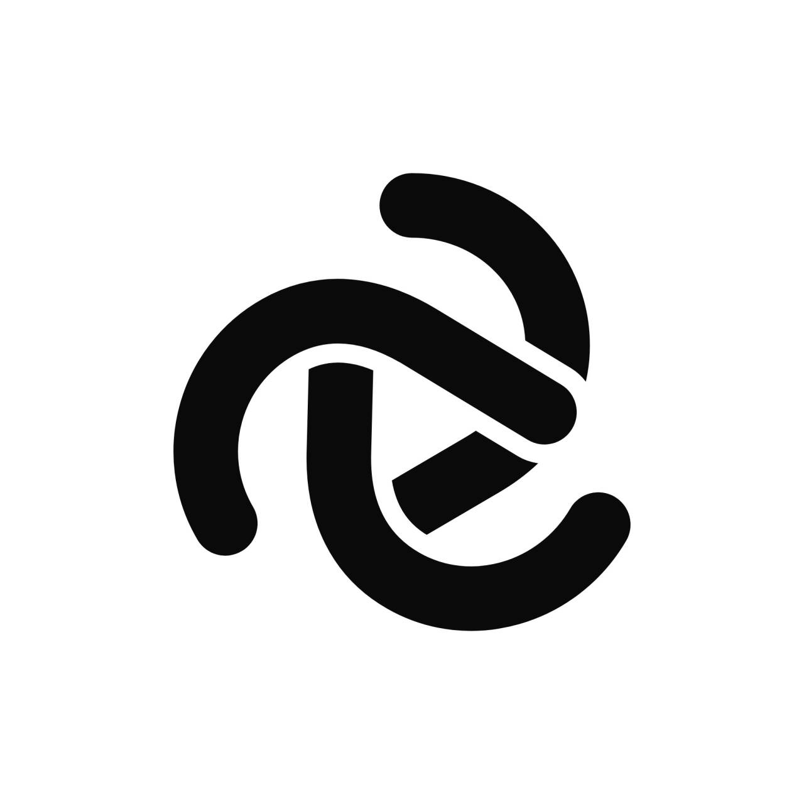

**简体中文** | [English](README.en.md)

<summary><strong>赞助与合作</strong></summary>

感谢以下赞助商与合作伙伴对 Axolotl Launcher 的支持。

<table>
  <tr>
    <td></td>
    <td><strong>CodeFlow</strong><br>更稳、更省地调用顶级 AI 模型<br>原生协议转发 · 无需海外网络 · 支付宝即充即用</td>
    <td><a href="https://codeflow.sh/register?invite=4UHP2KYH">访问 CodeFlow</a></td>
  </tr>
</table>

# 《启动按钮去哪了？》 · Axolotl Launcher 动画短片

为 **Axolotl Launcher（美西螈启动器）** 制作的动画短片，时长 87 秒，1920 × 1080，60 帧。光标正要点击启动器里粉色的「开始游戏」按钮，按钮却顺势沉出了界面，带着光标在启动器的真实功能里一路追逐：发现内容的搜索框和安装流程、实例的内容列表、实验室、种子地图（它在这里变成名叫「启动按钮」的粉色标记），最后到投影工坊。直到工坊自带的「层间距」把整个启动器重新合拢，第三次按下，世界终于打开。

画面中的一切都按产品源码（Axolotl Launcher v1.9.7）重建：配色、尺寸、图标、中文文案、方块贴图和品牌标识。配乐和每一个音效都在代码中合成。

## 交付内容

- **成片 · mod 图标版：** `videos/启动按钮去哪了-Axolotl-mod图标版.mp4`。发现内容的结果卡片、购物车栏、安装确认弹窗、下载提示和实例内容列表都显示真实的 mod 图标（Sodium、Lithium、Iris、Fabric API、Litematica、Mod Menu、MaLiLib）。图标取自各自的 Modrinth 页面，存放在 `public/images/mods/`，和启动器实际加载的是同一批图片，简介与下载量也用的是 Modrinth 上的真实数据。
- **成片 · 字母方块版：** `videos/启动按钮去哪了-Axolotl-字母方块版.mp4`。同一部片子，用中性的字母方块（Na / Li / FA …）代替第三方图标。
- 两版规格相同：1920 × 1080，60 帧，H.264 CRF 16，AAC 320 kb/s，87.0 秒，配乐响度 −16 LUFS / −1 dBTP。
- 版本切换：`npm run render` 默认出 mod 图标版；`npm run render:neutral` 出字母方块版（即传入 `--props={"modIcons":false}`）。代码开关在 `src/ui/ModIcon.tsx`（`MOD_ICONS`）。
- **可编辑工程：** 就是这个仓库（Remotion 4 + React/TypeScript，配合 Python 音频流水线）。
- `out/`（已被 git 忽略）用来存放渲染结果和审片截图，里面的内容都可以重新生成。

## 故事节拍（87 秒）

| 时间 | 模块 | 情节 |
|---|---|---|
| 0–9.75 秒 | M1 | 真实的极简主页。光标按下「开始游戏」，按钮却一路沉过插槽掉了下去。它探头回来，又再次掉落，光标跟着扑了下去。 |
| 9.75–13 秒 | M2 | 镜头拉开：启动器原来是一座小楼，各个真实页面像楼层一样叠在一起。 |
| 13–30.5 秒 | M3 | 发现内容：它在卡片上弹跳，钻进搜索框，伸展成粉色的焦点环；片名「启动按钮去哪了？」就打在按钮自己身上，结果是「这里还是空的」。光标四次扑空，却意外装上了「投影 (Litematica)」，它趁机骑着下载进度条进了实例。 |
| 30.5–40 秒 | M4 | 实例页：它不理会同样粉色的「双胞胎」按钮，藏成新 mod 的开关；再沿导航栏跳进实验室，从「种子地图」的「› 进入」像穿过活板门一样掉下去。 |
| 40–51.5 秒 | M5 | 种子地图：它混进樱花林，被找到、命名为「启动按钮」并存成粉色标记；再按一次，它又沉了下去。 |
| 51.5–63 秒 | M6 | 投影工坊：「松开以打开投影」接住了它，投影流程把它重建成方块，「框选」抓住了它，两个角色一起抬头望向这座小楼。 |
| 63–69 秒 | M7 | 「层间距」从 100% 拉到 0%，整个启动器重新合拢，按钮回到自己的插槽。 |
| 69–80 秒 | M8 | 回到主页。第三次按下，它没有再沉，镜头穿过 ▷ 进入黄昏的世界。 |
| 80–87 秒 | M9 | 片尾卡：「你的下一个世界，从这里开始。」 |

## 快速开始

```bash
npm install
npm run studio          # Remotion Studio：在 http://localhost:3000 逐帧预览、检查和修改每个镜头
npm run render          # mod 图标版 → out/where-is-the-launch-button.mp4（H.264，CRF 16，AAC 320k）
npm run render:neutral  # 字母方块版 → out/where-is-the-launch-button-neutral.mp4
npm run render:master   # ProRes HQ 母版 → out/master/
npm run audio           # 重新合成配乐 → public/audio/soundtrack.wav（需要 Python 3.12 + numpy/scipy/soundfile/pyloudnorm）
```

把一段帧渲染成静帧或审片拼图：

```bash
node scripts/stills.mjs WhereIsTheLaunchButton 0-5219:120 out/review --sheet --scale=0.5
```

## 工程结构

| 路径 | 内容 |
|---|---|
| `design/STORYBOARD.md` | 制作文档：时间轴（按帧）、镜头、衔接、配乐结构、音效提示表 |
| `design/concept-product.md` | 分镜所依据的详细镜头卡 |
| `research/PRODUCT_BIBLE.md` | 核实过的产品资料（配色、字体、布局、文案），以及分项调研报告 `research/0*.md` |
| `docs/session-log/` | 用 Claude Code 制作本片的完整时间线记录：对话、每条命令和文件改动、每个子代理的工作（由 `scripts/export-session-log.py` 从 Claude Code 的会话记录导出） |
| `src/film/` | 全局时间轴（`timeline.ts`）、镜头工具与投影计算、楼层、光标叠加层、`Film` 合成 |
| `src/scenes/M1…M9.tsx` | 全片九个模块（第 0 帧即模块起点），辅助代码在 `src/scenes/<模块>/` |
| `src/ui/` | 启动器界面的还原：外壳（`shell/AppWindow.tsx`）、基础组件（`kit.tsx`）、各页面（`pages/*`）、产品图标（`Icon.tsx`，由 `src/assets/icons` 生成）、mod 图标（`ModIcon.tsx`） |
| `src/characters/` | 主角按钮（`LaunchButton.tsx`）和光标（`Cursor.tsx`） |
| `src/stage/` | 2.5D 引擎：CSS-3D 舞台与镜头、带厚度的薄片、柔和投影、贴图方块 |
| `src/world/` | 结尾的黄昏方块世界 |
| `audio/` | 声音合成工具包（`lib/`）、配乐、音效提示表和混音器 |
| `public/` | 字体（Inter 3.19 + Noto Sans SC 子集，OFL 协议）、产品图片、方块贴图、mod 图标、渲染好的音频 |
| `videos/` | 两版成片 |

作为参考的产品源码没有放进本仓库。如需在本地查阅：`git clone https://github.com/Mystic-Stars/Axolotl upstream/Axolotl`（该目录已被 git 忽略）。

### 修改提示
- 时间点写在各模块的关键帧轨道里（`track(frame, [[f, v, ease], …])`），模块的起止帧在 `src/film/timeline.ts`。改某个模块的长度时，后面的模块要一起顺移。
- 镜头就是一组数据（`Cam {x, y, z, dist, pitch, yaw, roll, persp}`），`flatCam(floorZ)` 给出与真实应用完全一致的正视画面。
- 声音：修改 `audio/cues.py`（音效）或 `audio/score.py`（配乐），然后运行 `npm run audio`。

## 已做的质量检查
- 每个模块之间的衔接都在编码后的成片上核对过，没有跳变：衔接处的平均帧差与前后的运动一致，M7→M8、M8→M9 逐像素相同。
- 做过三轮 10 fps 逐帧动作审片，随后两轮修复：运动弧线、预备动作、落点穿模、镜头与光标的速度突变、构图、关键笑点的可读性、界面还原度。
- 配乐：确定性生成，每个预定的节拍点与对应帧的误差都在 ±0.5 毫秒以内；以上只是测量，还没有人真正听过，建议听一遍，需要时在 `audio/cues.py` / `audio/score.py` 里调整音量。
- 已知小瑕疵：66.8 秒楼层合拢时，发现内容页有约 0.1 秒的淡淡重影；39.1 秒按钮挤过活板门时是整体压扁，而不是真正的沙漏形。

## 致谢与授权
- Axolotl Launcher 的品牌标识和界面设计 © Axolotl Launcher 项目（Garbage Human Studio），用于该项目自己的宣传短片。
- 图标：产品自带图标集（源自 Lucide，ISC/MIT 协议）。
- 字体：Inter 3.19（SIL OFL 1.1）、Noto Sans SC（SIL OFL 1.1），协议文本在 `public/fonts/`。
- mod 图标归各自作者所有（CaffeineMC、Iris 团队、FabricMC、masa、TerraformersMC），片中只是像启动器本身那样作为界面内容展示。
- Minecraft 方块贴图同样只作为产品界面内容出现，与启动器本身一致。非 Minecraft 官方服务。未经 Mojang 或 Microsoft 批准，亦与其无关联。
- 使用 [Remotion](https://www.remotion.dev) 制作（个人和小团队免费；超过 3 人的公司商用渲染需要购买 Remotion 公司许可）。
