# Audio demo QC report

Generated 2026-10-06 12:33:34 by `audio/analyze.py` (48 files, 11.1 s).

Metrics: peak = sample peak dBFS; TP = true peak (4x oversampled) dBTP; LUFS = integrated (BS.1770; files < 0.5 s are zero-padded so the value reads like a momentary loudness); Mmax = max momentary (400 ms) loudness; centroid = spectral centroid; clicks = isolated sample-jump outliers; tail = trailing silence below -60 dBFS.

Hard flags (must be fixed): ABRUPT_END, ABRUPT_START, CLICKS, CLIP, DC, NAN, SR, TP>0. Advisory: TP>-1, TOO_QUIET, LATE_START, LONG_TAIL, PHASE.

| file | dur s | peak dBFS | TP dBTP | LUFS | Mmax | centroid Hz | DC | clicks | tail s | flags |
|---|---:|---:|---:|---:|---:|---:|---:|---:|---:|---|
| `public/audio/_demo/instrument_board.wav` | 19.01 | -1.1 | -1.1 | -16.0 | -13.3 | 446 | 1.4e-05 | 0 | 0.13 | ok |
| `public/audio/_demo/sfx_board.wav` | 56.64 | -3.0 | -2.8 | -21.7 | -14.1 | 708 | 2.6e-06 | 0 | 0.04 | ok |
| `public/audio/_demo/sfx/boing_high.wav` | 0.30 | -9.0 | -9.0 | -21.3 | -21.2 | 391 | 4.2e-07 | 0 | 0.03 | ok |
| `public/audio/_demo/sfx/boing_long.wav` | 0.88 | -9.0 | -9.0 | -20.2 | -16.6 | 240 | 1.5e-07 | 0 | 0.07 | ok |
| `public/audio/_demo/sfx/boing_low.wav` | 0.57 | -9.0 | -9.0 | -20.8 | -18.3 | 140 | 1.6e-07 | 0 | 0.05 | ok |
| `public/audio/_demo/sfx/boing_short.wav` | 0.35 | -9.0 | -9.0 | -20.9 | -20.9 | 291 | 2.9e-07 | 0 | 0.03 | ok |
| `public/audio/_demo/sfx/bounce_tap_plastic.wav` | 0.08 | -11.0 | -10.9 | -30.9 | -30.8 | 895 | 1.8e-04 | 0 | 0.01 | ok |
| `public/audio/_demo/sfx/bounce_tap_wood.wav` | 0.07 | -11.0 | -11.0 | -31.5 | -31.5 | 655 | 2.5e-04 | 0 | 0.01 | ok |
| `public/audio/_demo/sfx/button_press.wav` | 0.19 | -9.0 | -9.0 | -29.6 | -27.4 | 287 | 1.7e-05 | 0 | 0.01 | ok |
| `public/audio/_demo/sfx/card_flip.wav` | 0.22 | -13.0 | -12.9 | -33.5 | -31.1 | 2277 | 6.2e-07 | 0 | 0.01 | ok |
| `public/audio/_demo/sfx/caret_tick.wav` | 0.01 | -20.0 | -19.8 | -42.5 | -42.5 | 3318 | 1.7e-04 | 0 | 0.00 | ok |
| `public/audio/_demo/sfx/download_zip.wav` | 0.46 | -11.0 | -10.9 | -19.2 | -18.5 | 699 | 6.6e-06 | 0 | 0.01 | ok |
| `public/audio/_demo/sfx/fall_whistle.wav` | 1.09 | -16.0 | -16.0 | -18.4 | -16.3 | 1091 | 6.0e-08 | 0 | 0.01 | ok |
| `public/audio/_demo/sfx/heartbeat.wav` | 1.46 | -6.0 | -6.0 | -24.8 | -21.6 | 68 | 1.3e-07 | 0 | 0.02 | ok |
| `public/audio/_demo/sfx/hologram_shimmer.wav` | 3.58 | -12.0 | -12.0 | -22.6 | -19.9 | 1653 | 5.9e-08 | 0 | 0.24 | ok |
| `public/audio/_demo/sfx/hover_tick.wav` | 0.02 | -18.0 | -17.7 | -42.2 | -42.2 | 3437 | 3.6e-05 | 0 | 0.01 | ok |
| `public/audio/_demo/sfx/install_ticks.wav` | 1.59 | -14.0 | -13.8 | -28.7 | -26.4 | 1383 | 9.2e-07 | 0 | 0.17 | ok |
| `public/audio/_demo/sfx/key_click.wav` | 0.06 | -18.0 | -18.0 | -44.6 | -44.6 | 449 | 3.8e-06 | 0 | 0.00 | ok |
| `public/audio/_demo/sfx/land.wav` | 0.51 | -5.0 | -5.0 | -19.3 | -19.3 | 64 | 5.9e-06 | 0 | 0.03 | ok |
| `public/audio/_demo/sfx/launch_impact.wav` | 2.88 | -3.0 | -2.8 | -18.4 | -14.1 | 156 | 1.5e-06 | 0 | 0.07 | ok |
| `public/audio/_demo/sfx/map_rustle.wav` | 0.78 | -15.0 | -14.7 | -29.3 | -28.5 | 5743 | 3.6e-07 | 0 | 0.02 | ok |
| `public/audio/_demo/sfx/pin_drop.wav` | 0.17 | -8.0 | -8.0 | -29.7 | -29.7 | 502 | 8.4e-05 | 0 | 0.01 | ok |
| `public/audio/_demo/sfx/pop_bubble.wav` | 0.10 | -8.0 | -8.0 | -25.0 | -24.9 | 1067 | 2.7e-05 | 0 | 0.00 | ok |
| `public/audio/_demo/sfx/pop_cork.wav` | 0.18 | -8.0 | -7.8 | -28.1 | -28.1 | 743 | 5.9e-05 | 0 | 0.02 | ok |
| `public/audio/_demo/sfx/power_up.wav` | 1.60 | -6.0 | -6.0 | -18.4 | -14.9 | 357 | 2.1e-05 | 0 | 0.00 | ok |
| `public/audio/_demo/sfx/projector_hum.wav` | 3.00 | -20.1 | -20.1 | -29.3 | -28.9 | 122 | 1.8e-06 | 0 | 0.03 | ok |
| `public/audio/_demo/sfx/projector_off.wav` | 0.83 | -9.0 | -8.8 | -30.1 | -26.1 | 136 | 1.7e-05 | 0 | 0.03 | ok |
| `public/audio/_demo/sfx/projector_on.wav` | 1.02 | -9.0 | -8.8 | -27.2 | -26.2 | 122 | 1.1e-05 | 0 | 0.01 | ok |
| `public/audio/_demo/sfx/return.wav` | 1.47 | -9.0 | -9.0 | -21.1 | -16.9 | 1365 | 1.5e-07 | 0 | 0.01 | ok |
| `public/audio/_demo/sfx/rise.wav` | 1.50 | -9.0 | -9.0 | -20.5 | -16.4 | 1306 | 6.3e-07 | 0 | 0.00 | ok |
| `public/audio/_demo/sfx/slide_card.wav` | 0.60 | -13.0 | -12.9 | -23.0 | -22.4 | 3171 | 2.6e-07 | 0 | 0.01 | ok |
| `public/audio/_demo/sfx/slide_rough.wav` | 0.80 | -13.0 | -12.9 | -23.4 | -22.4 | 2976 | 1.6e-06 | 0 | 0.01 | ok |
| `public/audio/_demo/sfx/snap_into_place.wav` | 0.48 | -6.0 | -6.0 | -24.7 | -24.7 | 345 | 2.3e-06 | 0 | 0.03 | ok |
| `public/audio/_demo/sfx/sparkle.wav` | 1.62 | -13.0 | -13.0 | -25.3 | -21.5 | 3630 | 6.7e-08 | 0 | 0.08 | ok |
| `public/audio/_demo/sfx/squash.wav` | 0.32 | -10.0 | -10.0 | -24.8 | -22.6 | 310 | 1.1e-05 | 0 | 0.00 | ok |
| `public/audio/_demo/sfx/stretch.wav` | 0.50 | -10.0 | -10.0 | -17.9 | -17.3 | 376 | 7.7e-05 | 0 | 0.00 | ok |
| `public/audio/_demo/sfx/success_chime.wav` | 1.83 | -9.0 | -9.0 | -20.4 | -17.5 | 1326 | 2.8e-07 | 0 | 0.13 | ok |
| `public/audio/_demo/sfx/swish.wav` | 0.17 | -11.0 | -10.1 | -26.0 | -23.4 | 6638 | 3.2e-08 | 0 | 0.01 | ok |
| `public/audio/_demo/sfx/thud.wav` | 0.54 | -5.0 | -5.0 | -18.4 | -18.3 | 68 | 8.3e-06 | 0 | 0.03 | ok |
| `public/audio/_demo/sfx/toggle_off.wav` | 0.09 | -13.0 | -12.9 | -37.5 | -37.4 | 1147 | 1.0e-06 | 0 | 0.01 | ok |
| `public/audio/_demo/sfx/toggle_on.wav` | 0.09 | -13.0 | -12.9 | -37.4 | -37.4 | 1308 | 2.6e-06 | 0 | 0.01 | ok |
| `public/audio/_demo/sfx/typing.wav` | 1.06 | -16.0 | -15.8 | -37.6 | -36.4 | 1732 | 1.3e-06 | 0 | 0.00 | ok |
| `public/audio/_demo/sfx/ui_click.wav` | 0.03 | -14.0 | -14.0 | -38.5 | -38.5 | 2090 | 1.0e-04 | 0 | 0.01 | ok |
| `public/audio/_demo/sfx/whoosh_heavy_long.wav` | 1.37 | -7.0 | -7.0 | -19.4 | -16.6 | 568 | 4.5e-07 | 0 | 0.01 | ok |
| `public/audio/_demo/sfx/whoosh_heavy_short.wav` | 0.49 | -7.0 | -7.0 | -19.2 | -19.1 | 574 | 1.5e-05 | 0 | 0.01 | ok |
| `public/audio/_demo/sfx/whoosh_light_long.wav` | 0.88 | -8.0 | -7.9 | -18.1 | -16.3 | 4084 | 3.5e-07 | 0 | 0.01 | ok |
| `public/audio/_demo/sfx/whoosh_light_short.wav` | 0.30 | -8.0 | -7.9 | -18.6 | -18.4 | 4231 | 5.9e-06 | 0 | 0.01 | ok |
| `public/audio/_demo/sfx/wind_whoosh.wav` | 2.47 | -8.0 | -8.0 | -18.9 | -16.9 | 1224 | 6.7e-08 | 0 | 0.04 | ok |

## Details

### instrument_board.wav

- `public/audio/_demo/instrument_board.wav` - 19.01 s, 2 ch, 48000 Hz; peak -1.1 dBFS, TP -1.1 dBTP, LUFS -16.0, Mmax -13.3, short-term max -15.0, RMS -18.4 dBFS
- spectrum: centroid 446 Hz; energy % sub 5.0 / low 43.6 / mid 49.9 / presence 1.1 / brilliance 0.3 / air 0.12; narrow peaks (Hz, dB prominence): [(1758, 16.3), (1396, 15.7)]
- edges: first 0.0e+00, last 0.0e+00, last-1ms RMS -141.8 dB re peak; lead silence 0.000 s, tail 0.127 s; DC 1.4e-05; clipped 0; L/R corr 0.88
- flags: **ok**

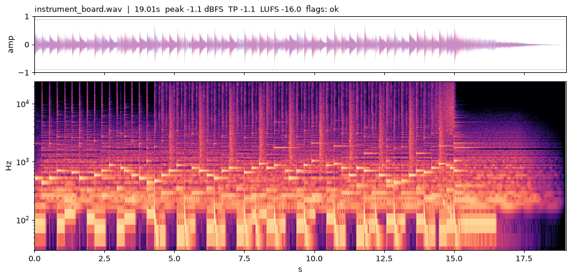

### sfx_board.wav

- `public/audio/_demo/sfx_board.wav` - 56.64 s, 2 ch, 48000 Hz; peak -3.0 dBFS, TP -2.8 dBTP, LUFS -21.7, Mmax -14.1, short-term max -18.5, RMS -26.3 dBFS
- spectrum: centroid 708 Hz; energy % sub 12.0 / low 38.9 / mid 42.5 / presence 5.6 / brilliance 1.0 / air 0.11; narrow peaks (Hz, dB prominence): none
- edges: first 0.0e+00, last 0.0e+00, last-1ms RMS -137.6 dB re peak; lead silence 0.000 s, tail 0.035 s; DC 2.6e-06; clipped 0; L/R corr 0.69
- flags: **ok**

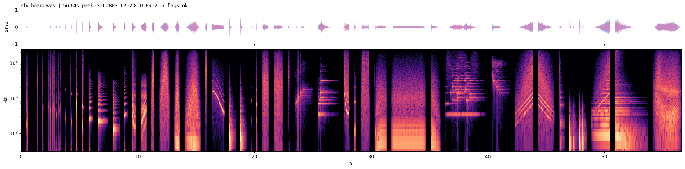

### boing_high.wav

- `public/audio/_demo/sfx/boing_high.wav` - 0.30 s, 2 ch, 48000 Hz; peak -9.0 dBFS, TP -9.0 dBTP, LUFS -21.3, Mmax -21.2, RMS -22.3 dBFS
- spectrum: centroid 391 Hz; energy % sub 0.0 / low 0.0 / mid 99.8 / presence 0.2 / brilliance 0.0 / air 0.00; narrow peaks (Hz, dB prominence): [(1061, 26.3), (1684, 25.0)]
- edges: first 0.0e+00, last 0.0e+00, last-1ms RMS -97.5 dB re peak; lead silence 0.000 s, tail 0.028 s; DC 4.2e-07; clipped 0; L/R corr 1.00
- flags: **ok**

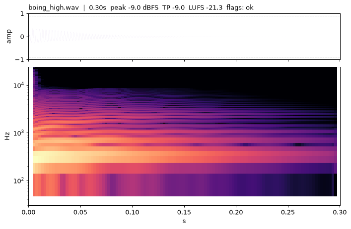

### boing_long.wav

- `public/audio/_demo/sfx/boing_long.wav` - 0.88 s, 2 ch, 48000 Hz; peak -9.0 dBFS, TP -9.0 dBTP, LUFS -20.2, Mmax -16.6, RMS -22.2 dBFS
- spectrum: centroid 240 Hz; energy % sub 0.0 / low 95.1 / mid 4.8 / presence 0.1 / brilliance 0.0 / air 0.00; narrow peaks (Hz, dB prominence): none
- edges: first 0.0e+00, last 0.0e+00, last-1ms RMS -88.6 dB re peak; lead silence 0.000 s, tail 0.074 s; DC 1.5e-07; clipped 0; L/R corr 1.00
- flags: **ok**

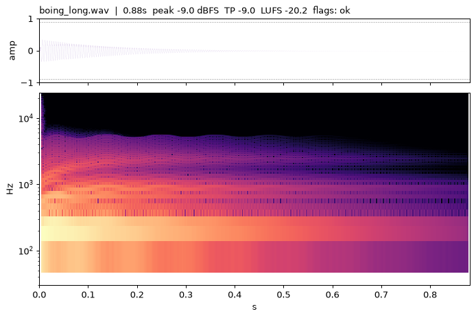

### boing_low.wav

- `public/audio/_demo/sfx/boing_low.wav` - 0.57 s, 2 ch, 48000 Hz; peak -9.0 dBFS, TP -9.0 dBTP, LUFS -20.8, Mmax -18.3, RMS -21.4 dBFS
- spectrum: centroid 140 Hz; energy % sub 0.0 / low 97.8 / mid 2.2 / presence 0.0 / brilliance 0.0 / air 0.00; narrow peaks (Hz, dB prominence): none
- edges: first 0.0e+00, last 0.0e+00, last-1ms RMS -98.0 dB re peak; lead silence 0.000 s, tail 0.048 s; DC 1.6e-07; clipped 0; L/R corr 1.00
- flags: **ok**

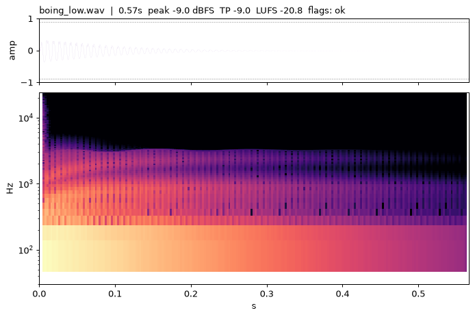

### boing_short.wav

- `public/audio/_demo/sfx/boing_short.wav` - 0.35 s, 2 ch, 48000 Hz; peak -9.0 dBFS, TP -9.0 dBTP, LUFS -20.9, Mmax -20.9, RMS -22.5 dBFS
- spectrum: centroid 291 Hz; energy % sub 0.0 / low 15.4 / mid 84.5 / presence 0.1 / brilliance 0.0 / air 0.00; narrow peaks (Hz, dB prominence): none
- edges: first 0.0e+00, last 0.0e+00, last-1ms RMS -90.1 dB re peak; lead silence 0.000 s, tail 0.033 s; DC 2.9e-07; clipped 0; L/R corr 1.00
- flags: **ok**

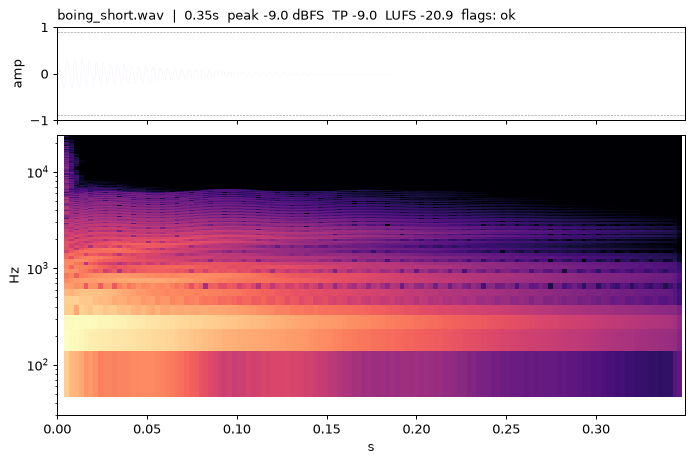

### bounce_tap_plastic.wav

- `public/audio/_demo/sfx/bounce_tap_plastic.wav` - 0.08 s, 2 ch, 48000 Hz; peak -11.0 dBFS, TP -10.9 dBTP, LUFS -30.9, Mmax -30.8, RMS -27.3 dBFS
- spectrum: centroid 895 Hz; energy % sub 0.1 / low 2.2 / mid 97.4 / presence 0.3 / brilliance 0.0 / air 0.00; narrow peaks (Hz, dB prominence): [(3466, 46.5), (1945, 42.3)]
- edges: first 0.0e+00, last 0.0e+00, last-1ms RMS -91.5 dB re peak; lead silence 0.000 s, tail 0.012 s; DC 1.8e-04; clipped 0; L/R corr 1.00
- flags: **ok**

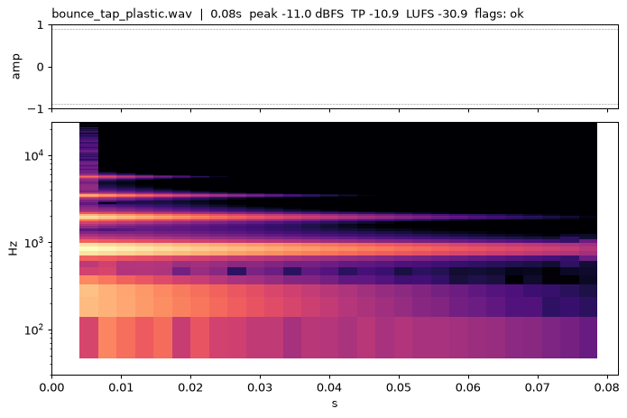

### bounce_tap_wood.wav

- `public/audio/_demo/sfx/bounce_tap_wood.wav` - 0.07 s, 2 ch, 48000 Hz; peak -11.0 dBFS, TP -11.0 dBTP, LUFS -31.5, Mmax -31.5, RMS -26.6 dBFS
- spectrum: centroid 655 Hz; energy % sub 0.2 / low 4.6 / mid 95.2 / presence 0.0 / brilliance 0.0 / air 0.00; narrow peaks (Hz, dB prominence): [(1733, 30.5)]
- edges: first 0.0e+00, last 0.0e+00, last-1ms RMS -103.4 dB re peak; lead silence 0.000 s, tail 0.011 s; DC 2.5e-04; clipped 0; L/R corr 1.00
- flags: **ok**

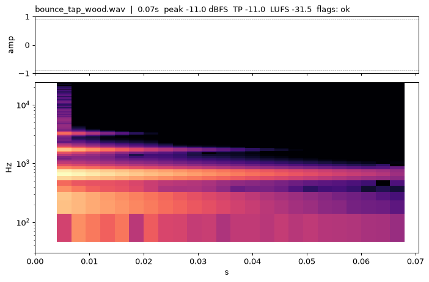

### button_press.wav

- `public/audio/_demo/sfx/button_press.wav` - 0.19 s, 2 ch, 48000 Hz; peak -9.0 dBFS, TP -9.0 dBTP, LUFS -29.6, Mmax -27.4, RMS -26.5 dBFS
- spectrum: centroid 287 Hz; energy % sub 1.0 / low 77.7 / mid 20.4 / presence 0.7 / brilliance 0.1 / air 0.02; narrow peaks (Hz, dB prominence): none
- edges: first 0.0e+00, last 0.0e+00, last-1ms RMS -100.9 dB re peak; lead silence 0.000 s, tail 0.010 s; DC 1.7e-05; clipped 0; L/R corr 1.00
- flags: **ok**

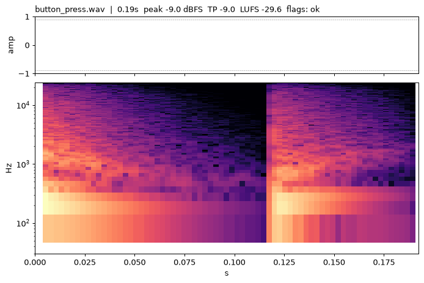

### card_flip.wav

- `public/audio/_demo/sfx/card_flip.wav` - 0.22 s, 2 ch, 48000 Hz; peak -13.0 dBFS, TP -12.9 dBTP, LUFS -33.5, Mmax -31.1, RMS -33.4 dBFS
- spectrum: centroid 2277 Hz; energy % sub 0.7 / low 14.0 / mid 51.1 / presence 26.2 / brilliance 7.0 / air 1.03; narrow peaks (Hz, dB prominence): none
- edges: first 0.0e+00, last 0.0e+00, last-1ms RMS -87.4 dB re peak; lead silence 0.001 s, tail 0.007 s; DC 6.2e-07; clipped 0; L/R corr 0.24
- flags: **ok**

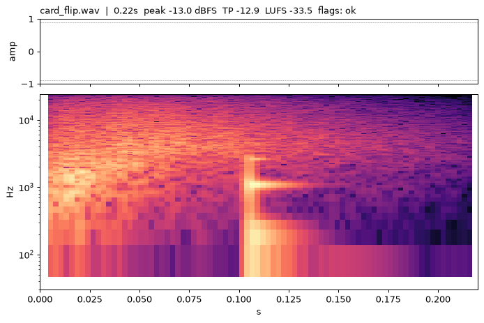

### caret_tick.wav

- `public/audio/_demo/sfx/caret_tick.wav` - 0.01 s, 2 ch, 48000 Hz; peak -20.0 dBFS, TP -19.8 dBTP, LUFS -42.5, Mmax -42.5, RMS -33.7 dBFS
- spectrum: centroid 3318 Hz; energy % sub 0.1 / low 0.1 / mid 0.0 / presence 99.0 / brilliance 0.8 / air 0.00; narrow peaks (Hz, dB prominence): [(6638, 30.0), (3272, 21.9)]
- edges: first 0.0e+00, last 0.0e+00, last-1ms RMS -88.2 dB re peak; lead silence 0.000 s, tail 0.005 s; DC 1.7e-04; clipped 0; L/R corr 1.00
- flags: **ok**

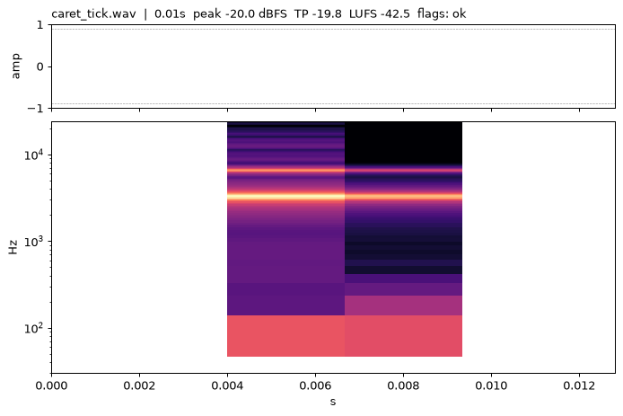

### download_zip.wav

- `public/audio/_demo/sfx/download_zip.wav` - 0.46 s, 2 ch, 48000 Hz; peak -11.0 dBFS, TP -10.9 dBTP, LUFS -19.2, Mmax -18.5, RMS -21.9 dBFS
- spectrum: centroid 699 Hz; energy % sub 0.0 / low 0.0 / mid 96.3 / presence 3.2 / brilliance 0.4 / air 0.08; narrow peaks (Hz, dB prominence): none
- edges: first 0.0e+00, last 0.0e+00, last-1ms RMS -99.9 dB re peak; lead silence 0.001 s, tail 0.011 s; DC 6.6e-06; clipped 0; L/R corr 0.91
- flags: **ok**

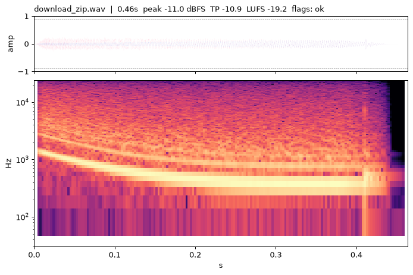

### fall_whistle.wav

- `public/audio/_demo/sfx/fall_whistle.wav` - 1.09 s, 2 ch, 48000 Hz; peak -16.0 dBFS, TP -16.0 dBTP, LUFS -18.4, Mmax -16.3, RMS -21.8 dBFS
- spectrum: centroid 1091 Hz; energy % sub 0.0 / low 0.0 / mid 99.8 / presence 0.2 / brilliance 0.0 / air 0.00; narrow peaks (Hz, dB prominence): [(1566, 17.6)]
- edges: first 0.0e+00, last 0.0e+00, last-1ms RMS -107.0 dB re peak; lead silence 0.002 s, tail 0.014 s; DC 6.0e-08; clipped 0; L/R corr 1.00
- flags: **ok**

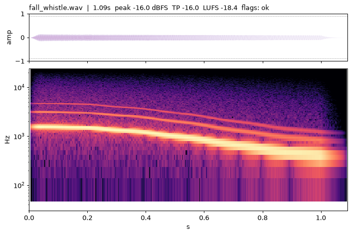

### heartbeat.wav

- `public/audio/_demo/sfx/heartbeat.wav` - 1.46 s, 2 ch, 48000 Hz; peak -6.0 dBFS, TP -6.0 dBTP, LUFS -24.8, Mmax -21.6, RMS -24.4 dBFS
- spectrum: centroid 68 Hz; energy % sub 51.9 / low 47.6 / mid 0.5 / presence 0.0 / brilliance 0.0 / air 0.00; narrow peaks (Hz, dB prominence): none
- edges: first 0.0e+00, last 0.0e+00, last-1ms RMS -127.0 dB re peak; lead silence 0.000 s, tail 0.022 s; DC 1.3e-07; clipped 0; L/R corr 1.00
- notes: mostly sub-bass energy
- flags: **ok**

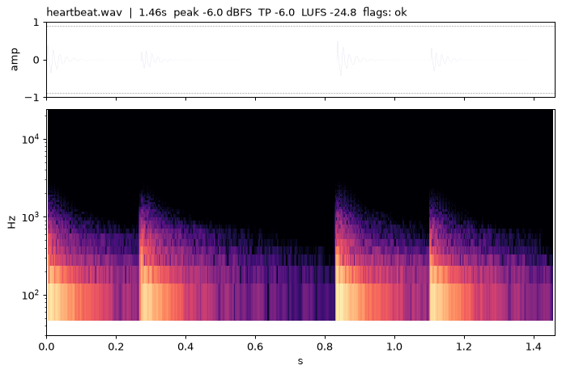

### hologram_shimmer.wav

- `public/audio/_demo/sfx/hologram_shimmer.wav` - 3.58 s, 2 ch, 48000 Hz; peak -12.0 dBFS, TP -12.0 dBTP, LUFS -22.6, Mmax -19.9, short-term max -23.9, RMS -29.1 dBFS
- spectrum: centroid 1653 Hz; energy % sub 0.0 / low 0.0 / mid 78.2 / presence 20.5 / brilliance 1.2 / air 0.04; narrow peaks (Hz, dB prominence): [(2091, 28.0), (1758, 23.2), (2634, 21.1), (1045, 21.0)]
- edges: first 0.0e+00, last 0.0e+00, last-1ms RMS -130.2 dB re peak; lead silence 0.025 s, tail 0.244 s; DC 5.9e-08; clipped 0; L/R corr 0.44
- flags: **ok**

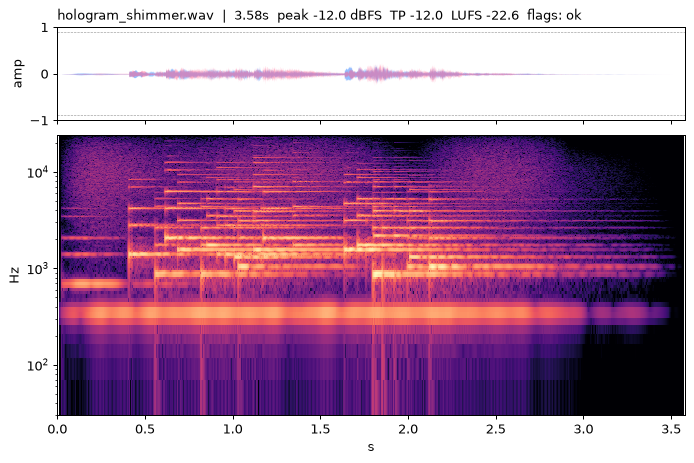

### hover_tick.wav

- `public/audio/_demo/sfx/hover_tick.wav` - 0.02 s, 2 ch, 48000 Hz; peak -18.0 dBFS, TP -17.7 dBTP, LUFS -42.2, Mmax -42.2, RMS -34.4 dBFS
- spectrum: centroid 3437 Hz; energy % sub 0.0 / low 0.0 / mid 1.0 / presence 99.0 / brilliance 0.0 / air 0.00; narrow peaks (Hz, dB prominence): [(4243, 26.6), (2152, 18.2)]
- edges: first 0.0e+00, last 0.0e+00, last-1ms RMS -90.8 dB re peak; lead silence 0.000 s, tail 0.005 s; DC 3.6e-05; clipped 0; L/R corr 1.00
- flags: **ok**

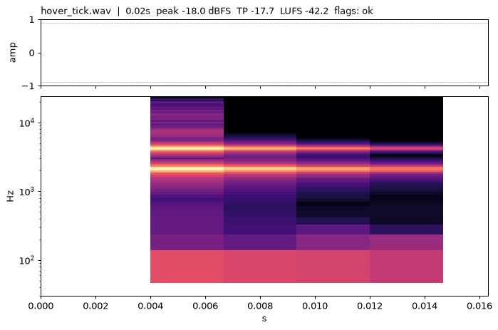

### install_ticks.wav

- `public/audio/_demo/sfx/install_ticks.wav` - 1.59 s, 2 ch, 48000 Hz; peak -14.0 dBFS, TP -13.8 dBTP, LUFS -28.7, Mmax -26.4, RMS -35.2 dBFS
- spectrum: centroid 1383 Hz; energy % sub 0.0 / low 0.0 / mid 98.7 / presence 0.5 / brilliance 0.7 / air 0.03; narrow peaks (Hz, dB prominence): [(10386, 16.7), (1758, 15.8)]
- edges: first 0.0e+00, last 0.0e+00, last-1ms RMS -123.3 dB re peak; lead silence 0.000 s, tail 0.174 s; DC 9.2e-07; clipped 0; L/R corr 0.91
- flags: **ok**

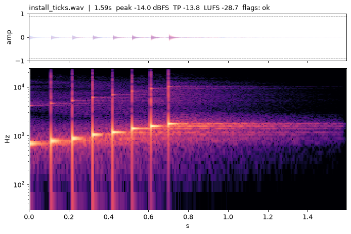

### key_click.wav

- `public/audio/_demo/sfx/key_click.wav` - 0.06 s, 2 ch, 48000 Hz; peak -18.0 dBFS, TP -18.0 dBTP, LUFS -44.6, Mmax -44.6, RMS -40.4 dBFS
- spectrum: centroid 449 Hz; energy % sub 6.6 / low 0.0 / mid 92.9 / presence 0.4 / brilliance 0.1 / air 0.01; narrow peaks (Hz, dB prominence): none
- edges: first 0.0e+00, last 0.0e+00, last-1ms RMS -94.5 dB re peak; lead silence 0.000 s, tail 0.005 s; DC 3.8e-06; clipped 0; L/R corr 1.00
- flags: **ok**

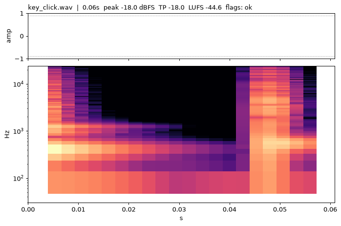

### land.wav

- `public/audio/_demo/sfx/land.wav` - 0.51 s, 2 ch, 48000 Hz; peak -5.0 dBFS, TP -5.0 dBTP, LUFS -19.3, Mmax -19.3, RMS -20.7 dBFS
- spectrum: centroid 64 Hz; energy % sub 47.5 / low 52.4 / mid 0.1 / presence 0.0 / brilliance 0.0 / air 0.00; narrow peaks (Hz, dB prominence): none
- edges: first 0.0e+00, last 0.0e+00, last-1ms RMS -125.4 dB re peak; lead silence 0.000 s, tail 0.028 s; DC 5.9e-06; clipped 0; L/R corr 0.99
- notes: mostly sub-bass energy
- flags: **ok**

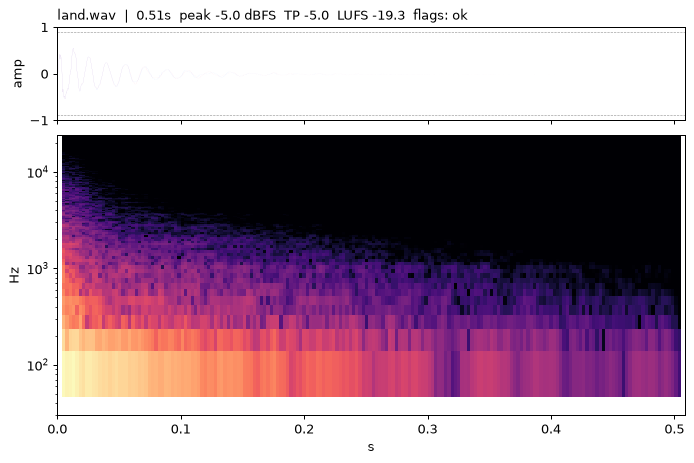

### launch_impact.wav

- `public/audio/_demo/sfx/launch_impact.wav` - 2.88 s, 2 ch, 48000 Hz; peak -3.0 dBFS, TP -2.8 dBTP, LUFS -18.4, Mmax -14.1, RMS -21.7 dBFS
- spectrum: centroid 156 Hz; energy % sub 7.8 / low 81.8 / mid 10.3 / presence 0.1 / brilliance 0.0 / air 0.04; narrow peaks (Hz, dB prominence): [(1045, 31.5), (1566, 29.5)]
- edges: first 0.0e+00, last 0.0e+00, last-1ms RMS -145.3 dB re peak; lead silence 0.000 s, tail 0.071 s; DC 1.5e-06; clipped 0; L/R corr 0.54
- flags: **ok**

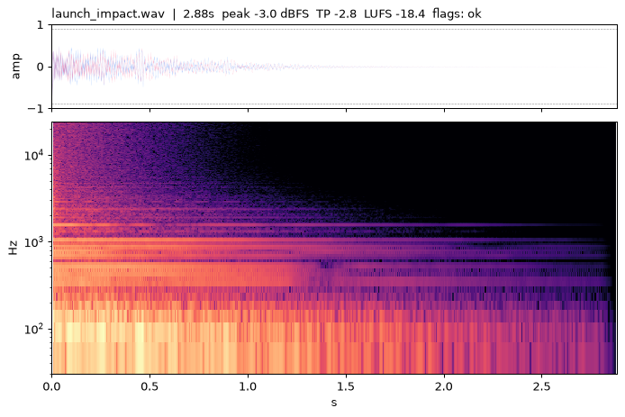

### map_rustle.wav

- `public/audio/_demo/sfx/map_rustle.wav` - 0.78 s, 2 ch, 48000 Hz; peak -15.0 dBFS, TP -14.7 dBTP, LUFS -29.3, Mmax -28.5, RMS -35.4 dBFS
- spectrum: centroid 5743 Hz; energy % sub 0.0 / low 0.4 / mid 21.6 / presence 36.3 / brilliance 34.7 / air 6.95; narrow peaks (Hz, dB prominence): none
- edges: first 0.0e+00, last 0.0e+00, last-1ms RMS -118.8 dB re peak; lead silence 0.014 s, tail 0.023 s; DC 3.6e-07; clipped 0; L/R corr 0.60
- flags: **ok**

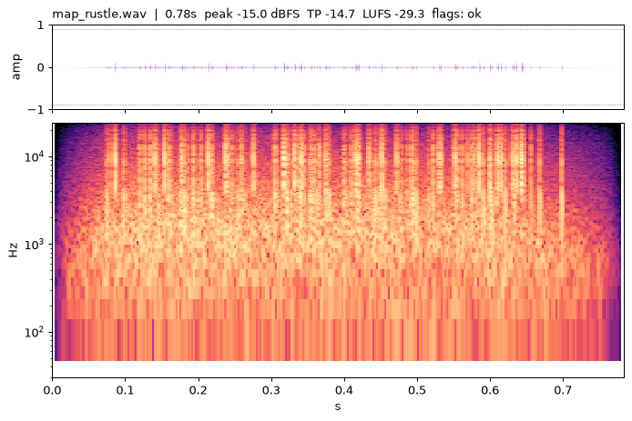

### pin_drop.wav

- `public/audio/_demo/sfx/pin_drop.wav` - 0.17 s, 2 ch, 48000 Hz; peak -8.0 dBFS, TP -8.0 dBTP, LUFS -29.7, Mmax -29.7, RMS -28.3 dBFS
- spectrum: centroid 502 Hz; energy % sub 1.6 / low 49.3 / mid 45.8 / presence 3.3 / brilliance 0.0 / air 0.00; narrow peaks (Hz, dB prominence): [(2061, 15.3)]
- edges: first 0.0e+00, last 0.0e+00, last-1ms RMS -117.7 dB re peak; lead silence 0.000 s, tail 0.013 s; DC 8.4e-05; clipped 0; L/R corr 1.00
- flags: **ok**

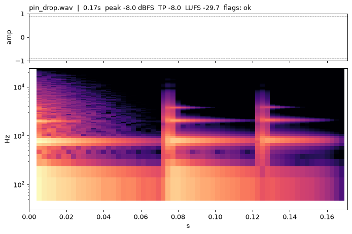

### pop_bubble.wav

- `public/audio/_demo/sfx/pop_bubble.wav` - 0.10 s, 2 ch, 48000 Hz; peak -8.0 dBFS, TP -8.0 dBTP, LUFS -25.0, Mmax -24.9, RMS -21.6 dBFS
- spectrum: centroid 1067 Hz; energy % sub 0.0 / low 0.0 / mid 99.0 / presence 1.0 / brilliance 0.0 / air 0.00; narrow peaks (Hz, dB prominence): [(2487, 22.3)]
- edges: first 0.0e+00, last 0.0e+00, last-1ms RMS -86.7 dB re peak; lead silence 0.000 s, tail 0.005 s; DC 2.7e-05; clipped 0; L/R corr 1.00
- flags: **ok**

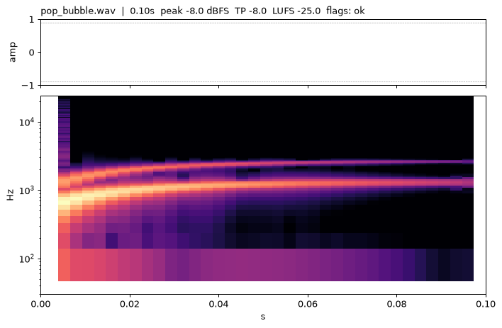

### pop_cork.wav

- `public/audio/_demo/sfx/pop_cork.wav` - 0.18 s, 2 ch, 48000 Hz; peak -8.0 dBFS, TP -7.8 dBTP, LUFS -28.1, Mmax -28.1, RMS -27.4 dBFS
- spectrum: centroid 743 Hz; energy % sub 0.0 / low 4.2 / mid 93.0 / presence 1.0 / brilliance 1.4 / air 0.39; narrow peaks (Hz, dB prominence): none
- edges: first 0.0e+00, last 0.0e+00, last-1ms RMS -94.1 dB re peak; lead silence 0.000 s, tail 0.021 s; DC 5.9e-05; clipped 0; L/R corr 1.00
- flags: **ok**

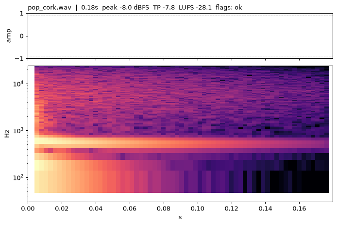

### power_up.wav

- `public/audio/_demo/sfx/power_up.wav` - 1.60 s, 2 ch, 48000 Hz; peak -6.0 dBFS, TP -6.0 dBTP, LUFS -18.4, Mmax -14.9, RMS -21.4 dBFS
- spectrum: centroid 357 Hz; energy % sub 0.0 / low 65.9 / mid 32.1 / presence 1.7 / brilliance 0.2 / air 0.02; narrow peaks (Hz, dB prominence): [(1758, 15.4)]
- edges: first 0.0e+00, last 0.0e+00, last-1ms RMS -61.0 dB re peak; lead silence 0.004 s, tail 0.001 s; DC 2.1e-05; clipped 0; L/R corr 0.94
- flags: **ok**

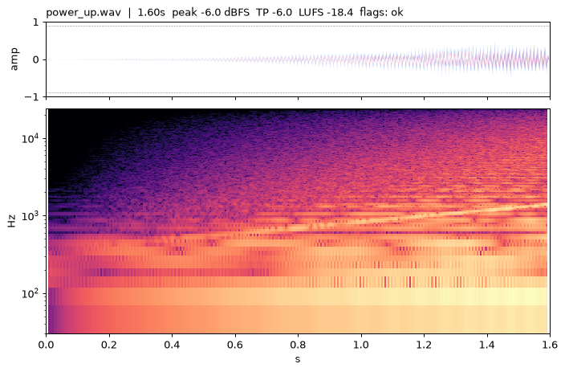

### projector_hum.wav

- `public/audio/_demo/sfx/projector_hum.wav` - 3.00 s, 2 ch, 48000 Hz; peak -20.1 dBFS, TP -20.1 dBTP, LUFS -29.3, Mmax -28.9, short-term max -29.7, RMS -29.9 dBFS
- spectrum: centroid 122 Hz; energy % sub 70.9 / low 24.2 / mid 4.5 / presence 0.3 / brilliance 0.0 / air 0.00; narrow peaks (Hz, dB prominence): none
- edges: first 0.0e+00, last 0.0e+00, last-1ms RMS -108.9 dB re peak; lead silence 0.019 s, tail 0.032 s; DC 1.8e-06; clipped 0; L/R corr 0.90
- flags: **ok**

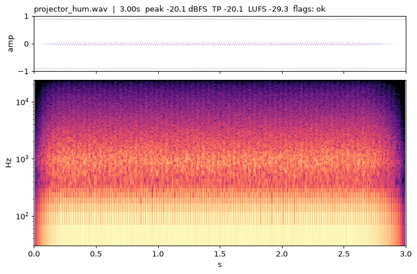

### projector_off.wav

- `public/audio/_demo/sfx/projector_off.wav` - 0.83 s, 2 ch, 48000 Hz; peak -9.0 dBFS, TP -8.8 dBTP, LUFS -30.1, Mmax -26.1, RMS -29.6 dBFS
- spectrum: centroid 136 Hz; energy % sub 67.7 / low 26.4 / mid 5.3 / presence 0.5 / brilliance 0.2 / air 0.02; narrow peaks (Hz, dB prominence): none
- edges: first 0.0e+00, last 0.0e+00, last-1ms RMS -128.8 dB re peak; lead silence 0.000 s, tail 0.033 s; DC 1.7e-05; clipped 0; L/R corr 0.91
- notes: mostly sub-bass energy
- flags: **ok**

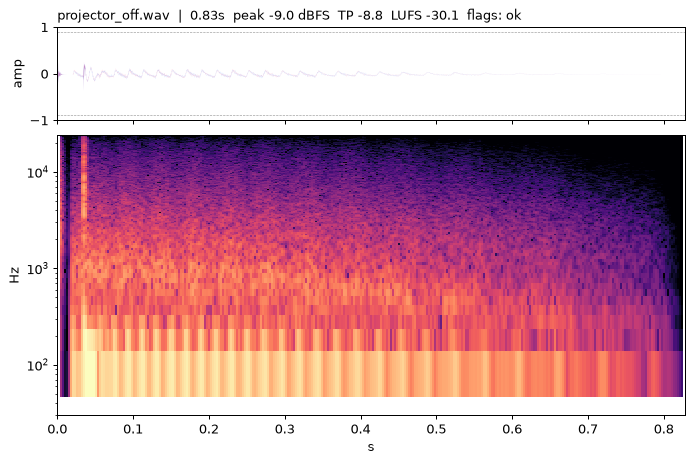

### projector_on.wav

- `public/audio/_demo/sfx/projector_on.wav` - 1.02 s, 2 ch, 48000 Hz; peak -9.0 dBFS, TP -8.8 dBTP, LUFS -27.2, Mmax -26.2, RMS -27.6 dBFS
- spectrum: centroid 122 Hz; energy % sub 68.2 / low 26.7 / mid 4.6 / presence 0.4 / brilliance 0.1 / air 0.01; narrow peaks (Hz, dB prominence): none
- edges: first 0.0e+00, last 0.0e+00, last-1ms RMS -103.4 dB re peak; lead silence 0.000 s, tail 0.006 s; DC 1.1e-05; clipped 0; L/R corr 0.91
- notes: mostly sub-bass energy
- flags: **ok**

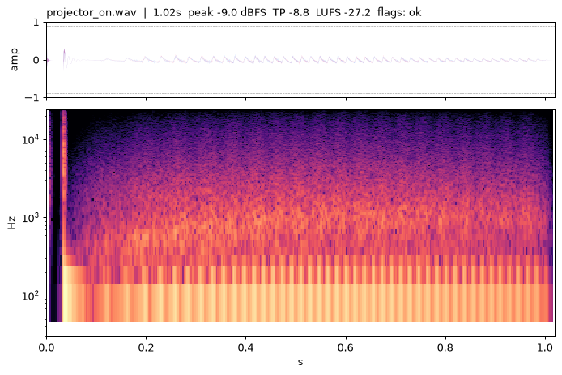

### return.wav

- `public/audio/_demo/sfx/return.wav` - 1.47 s, 2 ch, 48000 Hz; peak -9.0 dBFS, TP -9.0 dBTP, LUFS -21.1, Mmax -16.9, RMS -25.2 dBFS
- spectrum: centroid 1365 Hz; energy % sub 0.0 / low 0.0 / mid 88.4 / presence 8.8 / brilliance 2.5 / air 0.21; narrow peaks (Hz, dB prominence): none
- edges: first 0.0e+00, last 0.0e+00, last-1ms RMS -108.2 dB re peak; lead silence 0.002 s, tail 0.013 s; DC 1.5e-07; clipped 0; L/R corr 0.76
- flags: **ok**

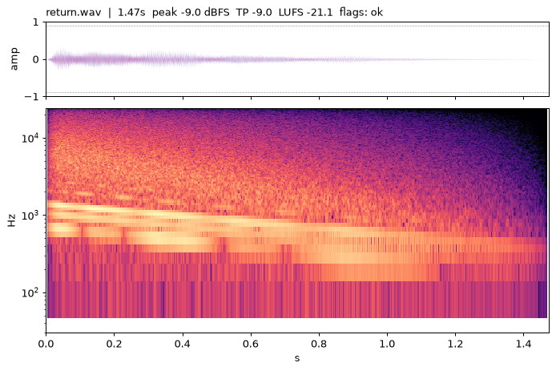

### rise.wav

- `public/audio/_demo/sfx/rise.wav` - 1.50 s, 2 ch, 48000 Hz; peak -9.0 dBFS, TP -9.0 dBTP, LUFS -20.5, Mmax -16.4, RMS -25.1 dBFS
- spectrum: centroid 1306 Hz; energy % sub 0.0 / low 0.1 / mid 88.9 / presence 8.7 / brilliance 2.1 / air 0.18; narrow peaks (Hz, dB prominence): none
- edges: first 0.0e+00, last 0.0e+00, last-1ms RMS -54.0 dB re peak; lead silence 0.003 s, tail 0.001 s; DC 6.3e-07; clipped 0; L/R corr 0.77
- flags: **ok**

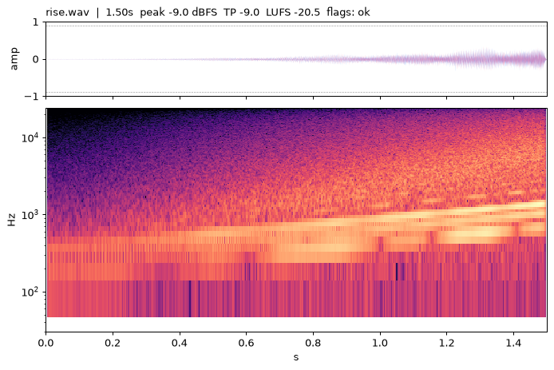

### slide_card.wav

- `public/audio/_demo/sfx/slide_card.wav` - 0.60 s, 2 ch, 48000 Hz; peak -13.0 dBFS, TP -12.9 dBTP, LUFS -23.0, Mmax -22.4, RMS -29.3 dBFS
- spectrum: centroid 3171 Hz; energy % sub 0.0 / low 0.3 / mid 28.4 / presence 63.3 / brilliance 7.2 / air 0.76; narrow peaks (Hz, dB prominence): none
- edges: first 0.0e+00, last 0.0e+00, last-1ms RMS -121.5 dB re peak; lead silence 0.004 s, tail 0.012 s; DC 2.6e-07; clipped 0; L/R corr 0.22
- flags: **ok**

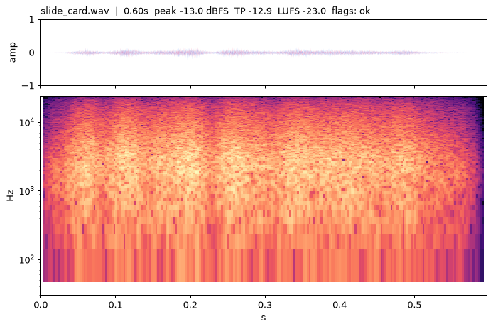

### slide_rough.wav

- `public/audio/_demo/sfx/slide_rough.wav` - 0.80 s, 2 ch, 48000 Hz; peak -13.0 dBFS, TP -12.9 dBTP, LUFS -23.4, Mmax -22.4, RMS -29.4 dBFS
- spectrum: centroid 2976 Hz; energy % sub 0.1 / low 0.4 / mid 37.5 / presence 55.2 / brilliance 6.2 / air 0.67; narrow peaks (Hz, dB prominence): none
- edges: first 0.0e+00, last 0.0e+00, last-1ms RMS -126.2 dB re peak; lead silence 0.005 s, tail 0.012 s; DC 1.6e-06; clipped 0; L/R corr 0.31
- flags: **ok**

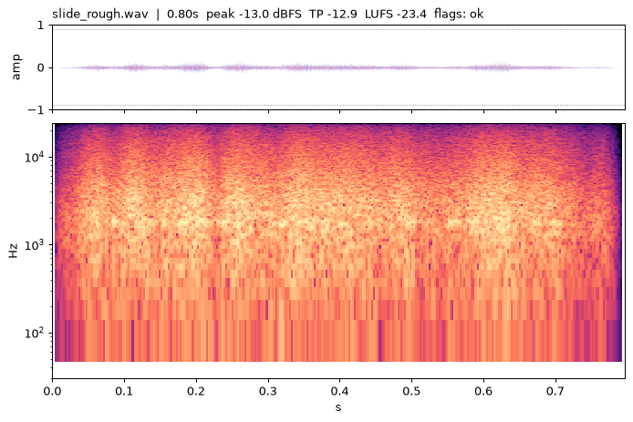

### snap_into_place.wav

- `public/audio/_demo/sfx/snap_into_place.wav` - 0.48 s, 2 ch, 48000 Hz; peak -6.0 dBFS, TP -6.0 dBTP, LUFS -24.7, Mmax -24.7, RMS -27.5 dBFS
- spectrum: centroid 345 Hz; energy % sub 8.1 / low 67.1 / mid 24.3 / presence 0.4 / brilliance 0.1 / air 0.03; narrow peaks (Hz, dB prominence): [(1045, 27.6)]
- edges: first 0.0e+00, last 0.0e+00, last-1ms RMS -111.2 dB re peak; lead silence 0.000 s, tail 0.027 s; DC 2.3e-06; clipped 0; L/R corr 0.96
- flags: **ok**

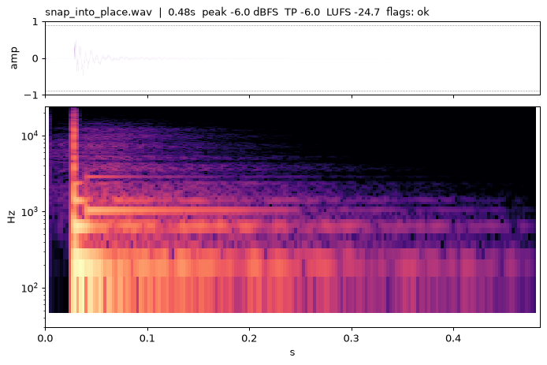

### sparkle.wav

- `public/audio/_demo/sfx/sparkle.wav` - 1.62 s, 2 ch, 48000 Hz; peak -13.0 dBFS, TP -13.0 dBTP, LUFS -25.3, Mmax -21.5, RMS -32.6 dBFS
- spectrum: centroid 3630 Hz; energy % sub 0.0 / low 0.0 / mid 7.0 / presence 89.1 / brilliance 3.8 / air 0.19; narrow peaks (Hz, dB prominence): [(4182, 28.8), (5582, 27.8), (1396, 25.3), (1758, 24.3)]
- edges: first 0.0e+00, last 0.0e+00, last-1ms RMS -125.9 dB re peak; lead silence 0.000 s, tail 0.080 s; DC 6.7e-08; clipped 0; L/R corr 0.55
- flags: **ok**

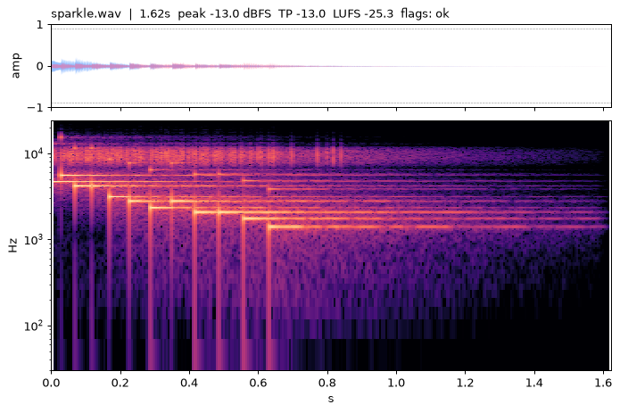

### squash.wav

- `public/audio/_demo/sfx/squash.wav` - 0.32 s, 2 ch, 48000 Hz; peak -10.0 dBFS, TP -10.0 dBTP, LUFS -24.8, Mmax -22.6, RMS -23.9 dBFS
- spectrum: centroid 310 Hz; energy % sub 0.0 / low 62.5 / mid 37.1 / presence 0.3 / brilliance 0.0 / air 0.01; narrow peaks (Hz, dB prominence): none
- edges: first 0.0e+00, last 0.0e+00, last-1ms RMS -56.8 dB re peak; lead silence 0.001 s, tail 0.001 s; DC 1.1e-05; clipped 0; L/R corr 1.00
- flags: **ok**

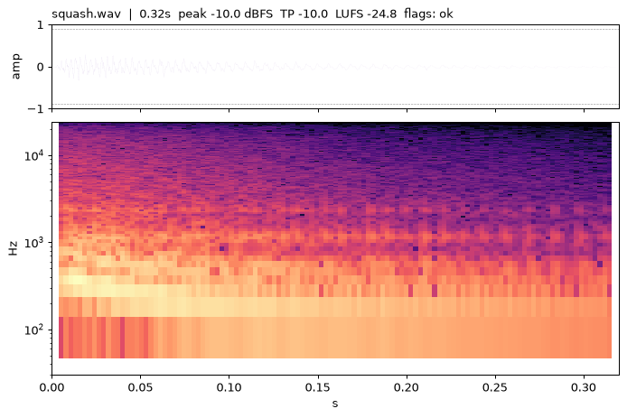

### stretch.wav

- `public/audio/_demo/sfx/stretch.wav` - 0.50 s, 2 ch, 48000 Hz; peak -10.0 dBFS, TP -10.0 dBTP, LUFS -17.9, Mmax -17.3, RMS -20.4 dBFS
- spectrum: centroid 376 Hz; energy % sub 0.0 / low 15.3 / mid 84.5 / presence 0.2 / brilliance 0.0 / air 0.00; narrow peaks (Hz, dB prominence): none
- edges: first 0.0e+00, last 0.0e+00, last-1ms RMS -68.3 dB re peak; lead silence 0.004 s, tail 0.001 s; DC 7.7e-05; clipped 0; L/R corr 1.00
- flags: **ok**

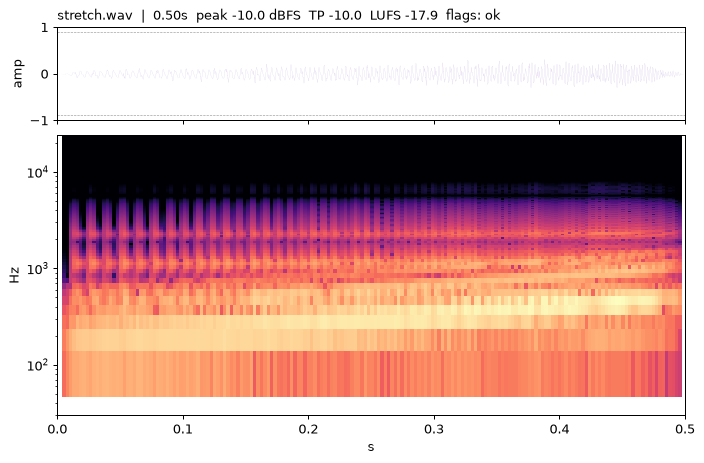

### success_chime.wav

- `public/audio/_demo/sfx/success_chime.wav` - 1.83 s, 2 ch, 48000 Hz; peak -9.0 dBFS, TP -9.0 dBTP, LUFS -20.4, Mmax -17.5, RMS -26.9 dBFS
- spectrum: centroid 1326 Hz; energy % sub 0.0 / low 0.0 / mid 96.1 / presence 3.7 / brilliance 0.2 / air 0.01; narrow peaks (Hz, dB prominence): [(3133, 33.9), (1566, 30.4), (1045, 26.9), (2091, 22.5)]
- edges: first 0.0e+00, last 0.0e+00, last-1ms RMS -130.1 dB re peak; lead silence 0.000 s, tail 0.126 s; DC 2.8e-07; clipped 0; L/R corr 0.81
- flags: **ok**

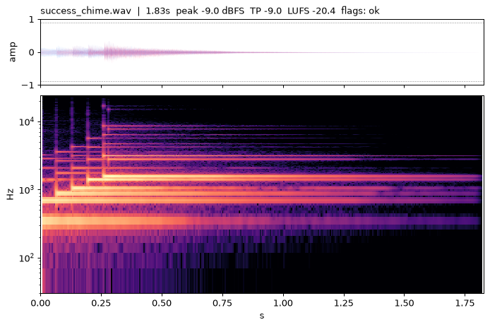

### swish.wav

- `public/audio/_demo/sfx/swish.wav` - 0.17 s, 2 ch, 48000 Hz; peak -11.0 dBFS, TP -10.1 dBTP, LUFS -26.0, Mmax -23.4, RMS -26.0 dBFS
- spectrum: centroid 6638 Hz; energy % sub 0.0 / low 0.0 / mid 0.7 / presence 44.7 / brilliance 49.4 / air 5.15; narrow peaks (Hz, dB prominence): none
- edges: first 0.0e+00, last 0.0e+00, last-1ms RMS -104.7 dB re peak; lead silence 0.003 s, tail 0.007 s; DC 3.2e-08; clipped 0; L/R corr 0.12
- flags: **ok**

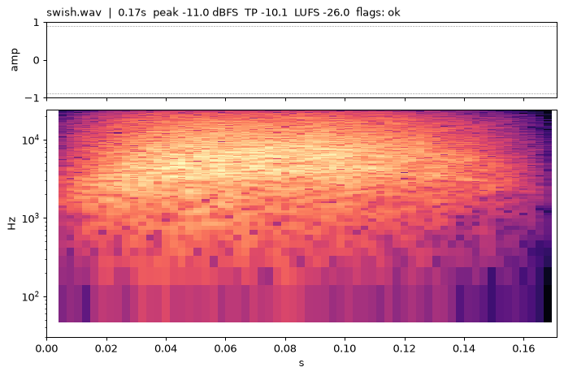

### thud.wav

- `public/audio/_demo/sfx/thud.wav` - 0.54 s, 2 ch, 48000 Hz; peak -5.0 dBFS, TP -5.0 dBTP, LUFS -18.4, Mmax -18.3, RMS -20.3 dBFS
- spectrum: centroid 68 Hz; energy % sub 20.2 / low 79.7 / mid 0.2 / presence 0.0 / brilliance 0.0 / air 0.00; narrow peaks (Hz, dB prominence): none
- edges: first 0.0e+00, last 0.0e+00, last-1ms RMS -121.3 dB re peak; lead silence 0.000 s, tail 0.034 s; DC 8.3e-06; clipped 0; L/R corr 0.99
- flags: **ok**

### toggle_off.wav

- `public/audio/_demo/sfx/toggle_off.wav` - 0.09 s, 2 ch, 48000 Hz; peak -13.0 dBFS, TP -12.9 dBTP, LUFS -37.5, Mmax -37.4, RMS -34.5 dBFS
- spectrum: centroid 1147 Hz; energy % sub 0.9 / low 54.0 / mid 33.1 / presence 6.6 / brilliance 4.8 / air 0.52; narrow peaks (Hz, dB prominence): [(1317, 18.6)]
- edges: first 0.0e+00, last 0.0e+00, last-1ms RMS -88.5 dB re peak; lead silence 0.000 s, tail 0.012 s; DC 1.0e-06; clipped 0; L/R corr 1.00
- flags: **ok**

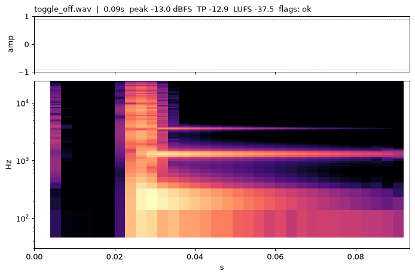

### toggle_on.wav

- `public/audio/_demo/sfx/toggle_on.wav` - 0.09 s, 2 ch, 48000 Hz; peak -13.0 dBFS, TP -12.9 dBTP, LUFS -37.4, Mmax -37.4, RMS -34.7 dBFS
- spectrum: centroid 1308 Hz; energy % sub 0.3 / low 5.3 / mid 82.1 / presence 6.8 / brilliance 4.9 / air 0.53; narrow peaks (Hz, dB prominence): [(1758, 22.4)]
- edges: first 0.0e+00, last 0.0e+00, last-1ms RMS -90.6 dB re peak; lead silence 0.000 s, tail 0.013 s; DC 2.6e-06; clipped 0; L/R corr 1.00
- flags: **ok**

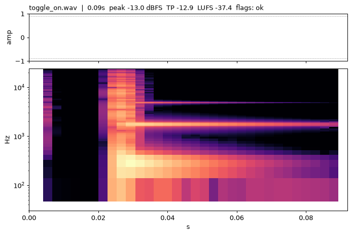

### typing.wav

- `public/audio/_demo/sfx/typing.wav` - 1.06 s, 2 ch, 48000 Hz; peak -16.0 dBFS, TP -15.8 dBTP, LUFS -37.6, Mmax -36.4, RMS -41.3 dBFS
- spectrum: centroid 1732 Hz; energy % sub 0.5 / low 3.4 / mid 67.8 / presence 21.9 / brilliance 5.6 / air 0.93; narrow peaks (Hz, dB prominence): none
- edges: first 0.0e+00, last 0.0e+00, last-1ms RMS -97.9 dB re peak; lead silence 0.000 s, tail 0.005 s; DC 1.3e-06; clipped 0; L/R corr 1.00
- flags: **ok**

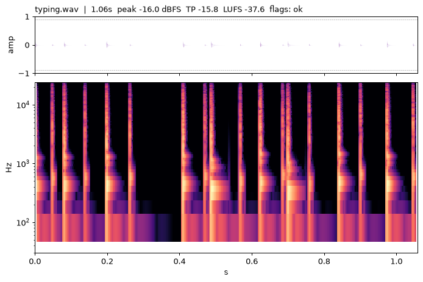

### ui_click.wav

- `public/audio/_demo/sfx/ui_click.wav` - 0.03 s, 2 ch, 48000 Hz; peak -14.0 dBFS, TP -14.0 dBTP, LUFS -38.5, Mmax -38.5, RMS -32.5 dBFS
- spectrum: centroid 2090 Hz; energy % sub 0.0 / low 0.0 / mid 48.2 / presence 51.1 / brilliance 0.7 / air 0.00; narrow peaks (Hz, dB prominence): [(6176, 33.6), (2915, 33.0), (1173, 18.7)]
- edges: first 0.0e+00, last 0.0e+00, last-1ms RMS -89.3 dB re peak; lead silence 0.000 s, tail 0.006 s; DC 1.0e-04; clipped 0; L/R corr 1.00
- flags: **ok**

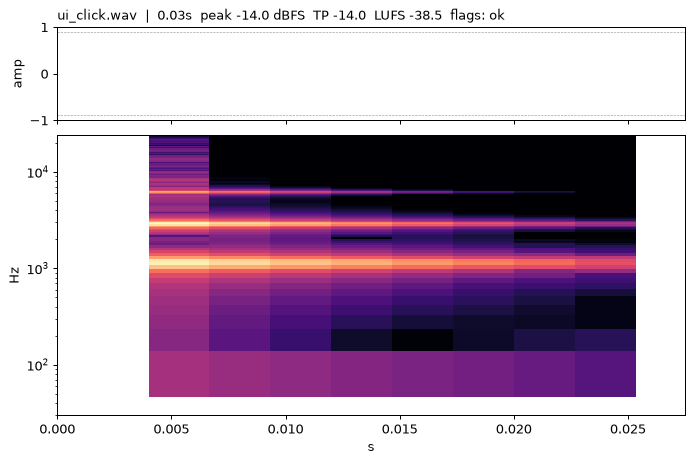

### whoosh_heavy_long.wav

- `public/audio/_demo/sfx/whoosh_heavy_long.wav` - 1.37 s, 2 ch, 48000 Hz; peak -7.0 dBFS, TP -7.0 dBTP, LUFS -19.4, Mmax -16.6, RMS -22.8 dBFS
- spectrum: centroid 568 Hz; energy % sub 55.5 / low 7.5 / mid 30.3 / presence 6.2 / brilliance 0.4 / air 0.05; narrow peaks (Hz, dB prominence): none
- edges: first 0.0e+00, last 0.0e+00, last-1ms RMS -107.0 dB re peak; lead silence 0.022 s, tail 0.010 s; DC 4.5e-07; clipped 0; L/R corr 0.43
- notes: mostly sub-bass energy
- flags: **ok**

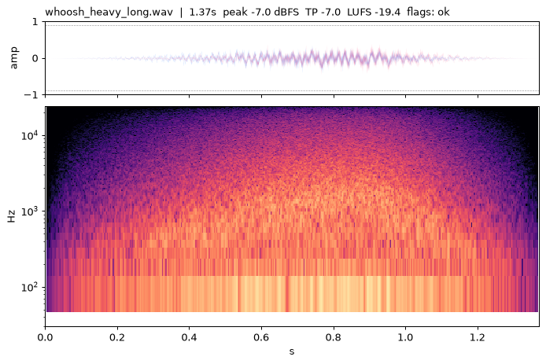

### whoosh_heavy_short.wav

- `public/audio/_demo/sfx/whoosh_heavy_short.wav` - 0.49 s, 2 ch, 48000 Hz; peak -7.0 dBFS, TP -7.0 dBTP, LUFS -19.2, Mmax -19.1, RMS -22.2 dBFS
- spectrum: centroid 574 Hz; energy % sub 53.8 / low 8.5 / mid 30.7 / presence 6.5 / brilliance 0.4 / air 0.05; narrow peaks (Hz, dB prominence): none
- edges: first 0.0e+00, last 0.0e+00, last-1ms RMS -114.8 dB re peak; lead silence 0.006 s, tail 0.008 s; DC 1.5e-05; clipped 0; L/R corr 0.43
- notes: mostly sub-bass energy
- flags: **ok**

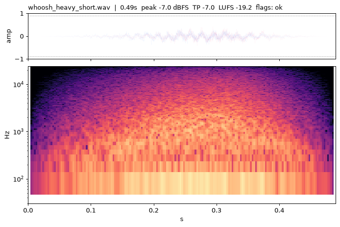

### whoosh_light_long.wav

- `public/audio/_demo/sfx/whoosh_light_long.wav` - 0.88 s, 2 ch, 48000 Hz; peak -8.0 dBFS, TP -7.9 dBTP, LUFS -18.1, Mmax -16.3, RMS -25.3 dBFS
- spectrum: centroid 4084 Hz; energy % sub 0.0 / low 0.2 / mid 16.7 / presence 66.8 / brilliance 15.1 / air 1.12; narrow peaks (Hz, dB prominence): none
- edges: first 0.0e+00, last 0.0e+00, last-1ms RMS -101.5 dB re peak; lead silence 0.017 s, tail 0.010 s; DC 3.5e-07; clipped 0; L/R corr 0.05
- flags: **ok**

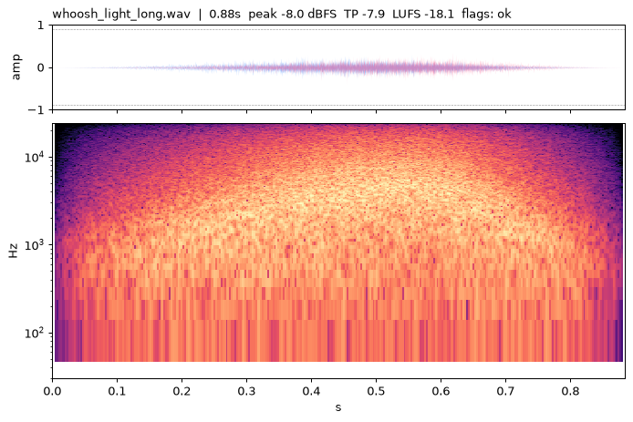

### whoosh_light_short.wav

- `public/audio/_demo/sfx/whoosh_light_short.wav` - 0.30 s, 2 ch, 48000 Hz; peak -8.0 dBFS, TP -7.9 dBTP, LUFS -18.6, Mmax -18.4, RMS -23.0 dBFS
- spectrum: centroid 4231 Hz; energy % sub 0.0 / low 0.2 / mid 16.3 / presence 65.0 / brilliance 17.1 / air 1.26; narrow peaks (Hz, dB prominence): none
- edges: first 0.0e+00, last 0.0e+00, last-1ms RMS -102.3 dB re peak; lead silence 0.005 s, tail 0.006 s; DC 5.9e-06; clipped 0; L/R corr 0.00
- flags: **ok**

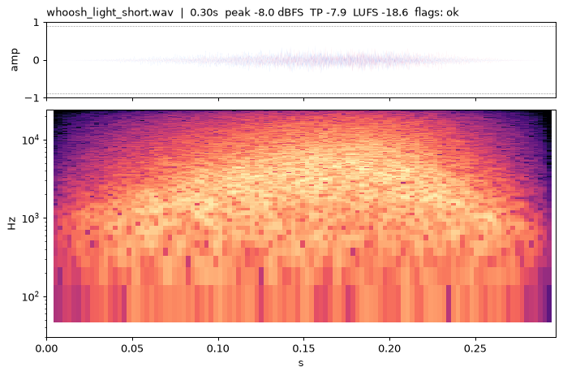

### wind_whoosh.wav

- `public/audio/_demo/sfx/wind_whoosh.wav` - 2.47 s, 2 ch, 48000 Hz; peak -8.0 dBFS, TP -8.0 dBTP, LUFS -18.9, Mmax -16.9, RMS -23.1 dBFS
- spectrum: centroid 1224 Hz; energy % sub 0.5 / low 12.6 / mid 72.6 / presence 12.6 / brilliance 1.5 / air 0.13; narrow peaks (Hz, dB prominence): none
- edges: first 0.0e+00, last 0.0e+00, last-1ms RMS -132.6 dB re peak; lead silence 0.029 s, tail 0.035 s; DC 6.7e-08; clipped 0; L/R corr 0.06
- flags: **ok**

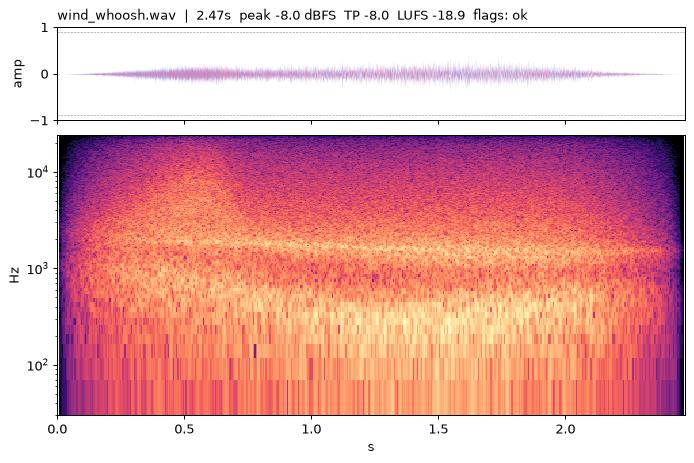

