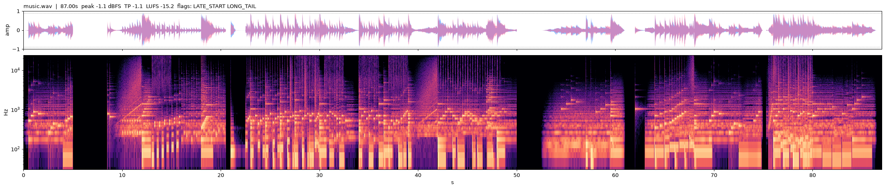
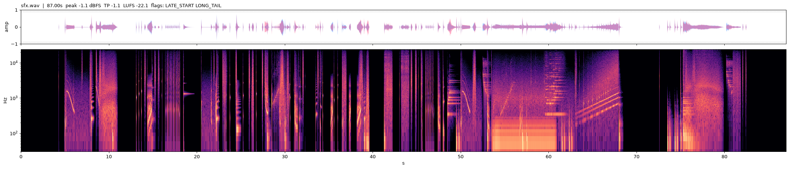
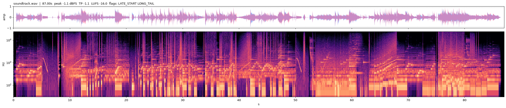

# Soundtrack QC report (audio/analyze.py)

Generated 2026-10-06 23:14:58 by `audio/analyze.py` (3 files, 16.9 s).

Metrics: peak = sample peak dBFS; TP = true peak (4x oversampled) dBTP; LUFS = integrated (BS.1770; files < 0.5 s are zero-padded so the value reads like a momentary loudness); Mmax = max momentary (400 ms) loudness; centroid = spectral centroid; clicks = isolated sample-jump outliers; tail = trailing silence below -60 dBFS.

Hard flags (must be fixed): ABRUPT_END, ABRUPT_START, CLICKS, CLIP, DC, NAN, SR, TP>0. Advisory: TP>-1, TOO_QUIET, LATE_START, LONG_TAIL, PHASE.

| file | dur s | peak dBFS | TP dBTP | LUFS | Mmax | centroid Hz | DC | clicks | tail s | flags |
|---|---:|---:|---:|---:|---:|---:|---:|---:|---:|---|
| `public/audio/music.wav` | 87.00 | -1.1 | -1.1 | -15.2 | -8.3 | 440 | 1.2e-05 | 0 | 0.55 | LATE_START LONG_TAIL |
| `public/audio/sfx.wav` | 87.00 | -1.1 | -1.1 | -22.1 | -13.1 | 911 | 4.1e-08 | 0 | 4.51 | LATE_START LONG_TAIL |
| `public/audio/soundtrack.wav` | 87.00 | -1.1 | -1.1 | -16.0 | -9.9 | 504 | 5.5e-06 | 0 | 0.55 | LATE_START LONG_TAIL |

## Details

### music.wav

- `public/audio/music.wav` - 87.00 s, 2 ch, 48000 Hz; peak -1.1 dBFS, TP -1.1 dBTP, LUFS -15.2, Mmax -8.3, short-term max -11.2, RMS -18.2 dBFS
- spectrum: centroid 440 Hz; energy % sub 6.3 / low 42.4 / mid 50.2 / presence 1.1 / brilliance 0.1 / air 0.02; narrow peaks (Hz, dB prominence): [(1396, 22.1), (1758, 20.8), (2091, 18.3), (1045, 15.2)]
- edges: first 0.0e+00, last 0.0e+00, last-1ms RMS -240.0 dB re peak; lead silence 0.144 s, tail 0.551 s; DC 1.2e-05; clipped 0; L/R corr 0.86
- flags: **LATE_START LONG_TAIL**

### sfx.wav

- `public/audio/sfx.wav` - 87.00 s, 2 ch, 48000 Hz; peak -1.1 dBFS, TP -1.1 dBTP, LUFS -22.1, Mmax -13.1, short-term max -19.2, RMS -27.2 dBFS
- spectrum: centroid 911 Hz; energy % sub 12.6 / low 26.8 / mid 49.3 / presence 9.4 / brilliance 1.6 / air 0.18; narrow peaks (Hz, dB prominence): none
- edges: first 0.0e+00, last 0.0e+00, last-1ms RMS -240.0 dB re peak; lead silence 4.300 s, tail 4.510 s; DC 4.1e-08; clipped 0; L/R corr 0.75
- flags: **LATE_START LONG_TAIL**

### soundtrack.wav

- `public/audio/soundtrack.wav` - 87.00 s, 2 ch, 48000 Hz; peak -1.1 dBFS, TP -1.1 dBTP, LUFS -16.0, Mmax -9.9, short-term max -12.4, RMS -18.6 dBFS
- spectrum: centroid 504 Hz; energy % sub 6.6 / low 39.6 / mid 51.4 / presence 2.1 / brilliance 0.2 / air 0.04; narrow peaks (Hz, dB prominence): [(1396, 16.6), (1758, 15.9)]
- edges: first 0.0e+00, last 0.0e+00, last-1ms RMS -240.0 dB re peak; lead silence 0.144 s, tail 0.551 s; DC 5.5e-06; clipped 0; L/R corr 0.84
- flags: **LATE_START LONG_TAIL**

